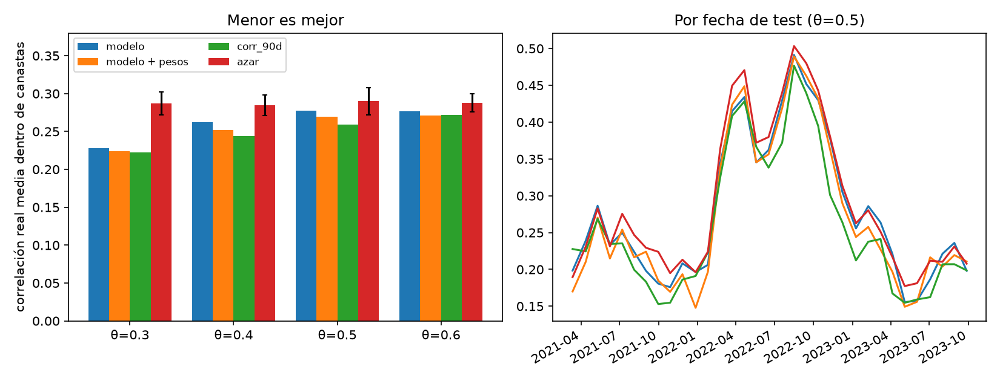

# Evaluación de las canastas en test

Generado con `python -m scripts.evaluar_canastas` (desde `backend/`). Para cada fecha de test se arma el grafo de conflicto con cada fuente de ρ, se colorea y se mide la correlación **real** (`corr_futura_60d`) entre las acciones de una misma canasta. Menos es mejor. El azar usa 20 semillas por fecha (se promedian primero por fecha).

- *pares con ρ real > θ*: fracción de pares dentro de una canasta que en la realidad habrían sido arista.
- *modelo + pesos*: la variante extra que usa ρ̂ para elegir entre colores válidos.
- Cuidado al comparar: a igual θ, cada fuente genera grafos de distinta densidad y por eso distinta cantidad de canastas; menos canastas obliga a juntar más acciones.

| theta | variante | corr. real media en canastas | pares con ρ real > θ | canastas (media) | aristas (media) |
|---|---|---|---|---|---|
| 0.300 | azar | 0.287 | 0.481 | 6.650 | 152 |
| 0.300 | corr_90d | 0.223 | 0.347 | 12.061 | 202 |
| 0.300 | modelo | 0.228 | 0.365 | 9.848 | 172 |
| 0.300 | modelo + pesos | 0.224 | 0.352 | 10.030 | 172 |
| 0.400 | azar | 0.284 | 0.317 | 5.900 | 129 |
| 0.400 | corr_90d | 0.244 | 0.246 | 9.515 | 133 |
| 0.400 | modelo | 0.262 | 0.277 | 5.727 | 60 |
| 0.400 | modelo + pesos | 0.252 | 0.266 | 5.818 | 60 |
| 0.500 | azar | 0.290 | 0.187 | 5.200 | 108 |
| 0.500 | corr_90d | 0.259 | 0.129 | 6.909 | 74 |
| 0.500 | modelo | 0.278 | 0.157 | 3.303 | 15 |
| 0.500 | modelo + pesos | 0.270 | 0.158 | 3.303 | 15 |
| 0.600 | azar | 0.288 | 0.087 | 4.700 | 86 |
| 0.600 | corr_90d | 0.272 | 0.059 | 4.697 | 33 |
| 0.600 | modelo | 0.276 | 0.064 | 3.000 | 9 |
| 0.600 | modelo + pesos | 0.271 | 0.063 | 3.000 | 9 |

Desvío estándar entre semillas del azar (corr. media): θ=0.3: 0.015, θ=0.4: 0.014, θ=0.5: 0.018, θ=0.6: 0.012

