# Diversificación de carteras con predicción de correlaciones

**Trabajo Práctico Integrador — Lógica y Teoría de Grafos**

Integrantes: **Manuel García de la Vega y Santiago Ferrer Petit**
Fecha de entrega: 08/11/2026
Repositorio: https://github.com/santiferrerpetit/diversificacion-carteras

> **Estado: borrador.** Los puntos marcados con **[COMPLETAR]** necesitan datos o decisiones que no están en el repositorio (nombres, sección de uso de IA). Todos los números salen de `data/metricas.json`, `data/evaluacion_canastas.csv` y los notebooks de `notebooks/`, y se regeneran con los scripts indicados al final.

---

## Resumen

Construimos un sistema que agrupa 30 acciones del S&P 500 en **canastas diversificadas**, es decir, conjuntos de acciones en los que ningún par se mueva junto. Un modelo de regresión predice la correlación futura (a 60 días hábiles) de cada par de acciones; esas predicciones definen las aristas de un grafo de conflicto, y un coloreo propio del grafo reparte las acciones en canastas. Una aplicación web (FastAPI y React) permite cambiar el umbral y la fecha de corte y ver cómo cambian el grafo y las canastas.

Resultado principal, dicho con honestidad: el modelo mejora poco a la línea base que usa la correlación de los últimos 90 días (la mejor regresión baja el error absoluto medio un 3 %), y las canastas armadas con el modelo **no** quedan mejor diversificadas que las armadas con la correlación histórica. Sí quedan claramente mejor que las armadas al azar. Además, el grafo armado con el modelo no refleja los cambios de régimen del mercado (en la crisis de 2020 el número de canastas no sube, mientras que con la correlación histórica se triplica). Detalle en las secciones 4, 6 y 8.

---

## 1. El problema y las decisiones de diseño

### 1.1 Quién tiene el problema y qué decisión se quiere tomar

Una plataforma de inversiones quiere ayudar a sus clientes a armar carteras realmente diversificadas. Hoy sugiere "comprar acciones de distintos sectores", pero eso no alcanza: dos acciones de sectores distintos pueden moverse casi igual, y la correlación entre acciones cambia con el tiempo (en las crisis suele subir justo cuando más se necesita diversificar). La alternativa habitual es usar la correlación histórica, que mira al pasado y no a lo que va a pasar.

La decisión es **qué acciones agrupar en una misma canasta** y **cuántas canastas hacen falta**, de modo que dentro de cada canasta las acciones no se muevan juntas.

### 1.2 Por qué un grafo

El modelo de regresión solo entrega un número por par de acciones (435 valores ρ̂(i,j) para 30 acciones). Eso no le dice al cliente qué acciones juntar. Hace falta una **partición global** de las acciones en canastas, y mirar pares sueltos no alcanza: A-B y B-C pueden ser compatibles y A-C no. El coloreo propio de un grafo considera todas las combinaciones a la vez y garantiza que ninguna canasta contiene una arista. Ver la sección 7 para la comparación con alternativas como el clustering.

El planteo es el de un **grafo de conflicto**, igual al de las peceras de la práctica de coloreo (hay elementos que no pueden compartir contenedor y se pide el mínimo de contenedores):

| Práctica                        | Nuestro problema                                |
| ------------------------------- | ----------------------------------------------- |
| Peces (depredador-presa)        | Acciones                                        |
| Arista = no pueden estar juntos | Arista = correlación predicha > umbral θ |
| Pecera                          | Canasta                                         |
| Mínimo de peceras               | χ(G) = mínimo de canastas                  |

### 1.3 Decisiones de diseño principales

Las decisiones completas, con su justificación, están en `documentacion/decisiones.md`. Las más importantes:

- **Stack:** backend en Python (FastAPI, scikit-learn, pandas) y frontend en React con TypeScript.
- **Datos fijos y reproducibles:** los precios se descargan una sola vez y se guardan en el repositorio, para que el resultado no dependa de que Yahoo Finance siga disponible.
- **Los algoritmos de grafos se implementan a mano.** `networkx` se usa solo en los tests y en un script de comparación, para contrastar los resultados y generar grafos al azar.
- **El umbral θ es un parámetro del usuario**, no un valor fijo, porque no hay un θ "correcto": depende de cuántas canastas se quiera manejar.

---

## 2. Dataset

### 2.1 Fuente

Precios diarios de cierre ajustado (con splits y dividendos) de **30 acciones del S&P 500 y del ETF `SPY`**, descargados con `yfinance` (Yahoo Finance) del 2014-01-02 al 2023-12-29 (2516 días hábiles, sin valores faltantes). `yfinance` es una librería de código abierto que usa los endpoints públicos de Yahoo; no es una API oficial ni está afiliada a Yahoo, y su documentación indica uso personal o educativo. La descarga se hizo una sola vez (`backend/scripts/descargar_precios.py`) y el resultado está en `data/precios.csv`.

Las 30 acciones cubren los 11 sectores y mezclan pares muy correlacionados (por ejemplo JPM-BAC, XOM-CVX) con pares casi independientes (NEM-NVDA, KO-TSLA), para que el modelo vea todo el rango de correlaciones. La lista y el criterio están en `documentacion/ACCIONES.md`. El sector de cada acción está en una tabla propia, `data/sectores.csv`, armada a mano: `yf.Ticker(t).info["sector"]` es lento y a veces falla.

### 2.2 Transformaciones

1. **Retornos diarios:** `precio_hoy / precio_ayer - 1`. La correlación debe medir cómo se mueven las acciones y no su nivel de precio.
2. **Fechas de corte:** una cada 20 días hábiles (aproximadamente un mes). Con una por día las ventanas se superponen casi por completo y las filas serían casi copias. Se descartan los cortes sin 250 días de historia previa y los que no tienen 60 días hábiles posteriores. Resultan **111 fechas de corte**, de 2014-12-30 a 2023-09-27.
3. **Pares:** con 30 acciones hay C(30, 2) = 435 pares, cada uno una sola vez (con `accion_id_1 < accion_id_2` en orden alfabético).
4. **Dataset por pares:** una fila por par y fecha de corte, **48 285 filas** (435 × 111), en `data/dataset_pares.csv`. Se genera con `python -m scripts.construir_dataset`.

### 2.3 Features y por qué

| Feature                             | Qué es                                                     | Por qué                                                                                            |
| ----------------------------------- | ---------------------------------------------------------- | -------------------------------------------------------------------------------------------------- |
| `corr_30d`, `corr_90d`, `corr_250d` | Correlación de retornos en las últimas 30, 90 y 250 ruedas | Tres ventanas para captar el comportamiento reciente y el de largo plazo                           |
| `mismo_sector`                      | 1 si las dos acciones son del mismo sector                 | Acciones del mismo sector tienden a moverse juntas                                                 |
| `dif_volatilidad`                   | abs(σ₁ − σ₂) con σ de las últimas 90 ruedas                 | Acciones con volatilidad muy distinta tienden a moverse menos juntas                               |
| `dif_beta`                          | abs(β₁ − β₂), β = cov(acción, SPY) / var(SPY) en 90 ruedas  | Mide qué tan distinta es la sensibilidad al mercado                                                |
| `volatilidad_mercado`               | σ de `SPY` en las últimas 90 ruedas                        | En las crisis las correlaciones suben; esta columna le dice al modelo en qué clima está el mercado |
| **`corr_futura_60d`** (target)      | Correlación de los 60 retornos siguientes al corte         | Es lo que se quiere predecir                                                                       |

Decisiones sobre las features:

- **Valor absoluto en las diferencias**, para que el resultado no dependa del orden del par.
- **Ventana de 90 días** para volatilidad y beta: es un punto medio entre ruido (30 días) y lentitud (250 días), y coincide con `corr_90d`, que es la línea base. Es una elección nuestra y otras ventanas serían defendibles.
- **No entran como features** los ids de las acciones ni la fecha: con los ids el modelo podría memorizar pares puntuales, y con la fecha no podría generalizar a períodos futuros.
- **El beta se calcula nosotros** con una regresión rodante contra `SPY`. El `beta` de `yfinance` es un valor actual, y usarlo en fechas pasadas filtraría información del futuro.

Correlación de cada feature con el target en todo el dataset (notebook `01-dataset`): `corr_90d` 0,48; `corr_250d` 0,45; `corr_30d` 0,44; `dif_beta` −0,27; `mismo_sector` 0,22; `dif_volatilidad` −0,15; `volatilidad_mercado` 0,13. Que `corr_90d` ya correlacione tanto con el target anticipa que el baseline sea difícil de superar.

### 2.4 Anti-leakage

Leakage (fuga de información) es cuando una feature usa por error información del futuro: el modelo parecería muy bueno al entrenar y fallaría en uso real. Para evitarlo:

- Todas las features usan solo retornos con fecha **≤ `fecha_corte`**. Solo `corr_futura_60d` mira hacia adelante.
- **Test unitario** (`test_features_no_usan_datos_posteriores_al_corte`, en `backend/tests/test_dataset.py`): altera todos los precios posteriores a un corte y comprueba que las features de ese corte y de los anteriores no cambian, mientras que el target sí. Se comprobó también que el test **falla** si se introduce una fuga a propósito.
- **Partición temporal con gap** (sección 4.2), para que el target de train no se solape con test.
- **Verificación con datos reales** (notebook `01-dataset`): para un par y una fecha, las features calculadas a mano coinciden con las del dataset y las ventanas de las features terminan antes de que empiece la del target.

---

## 3. Modelos de regresión

Se comparan los tres modelos pedidos que aplican a regresión, contra una línea base:

| Modelo                                     | Hiperparámetros probados                                            |
| ------------------------------------------ | ------------------------------------------------------------------- |
| **Baseline**                               | Ninguno: predice que la correlación futura es `corr_90d`            |
| Regresión lineal (features estandarizadas) | —                                                                   |
| kNN (features estandarizadas)              | `k` ∈ {15, 50, 150, 400, 1000}                                      |
| Árbol de decisión                          | `max_depth` ∈ {2, 3, 5, 8} × `min_samples_leaf` ∈ {5, 20, 100, 400} |

Se usan los algoritmos de `scikit-learn` entrenados con nuestro dataset, y no modelos preentrenados: la tarea es específica (correlación a 60 días entre pares de estas 30 acciones, con estas features) y no existe un modelo ya entrenado para ella. Con una tabla de 7 columnas y unas 48 mil filas, los modelos simples alcanzan y uno grande se sobreajustaría.

### 3.1 Cómo se entrenó cada modelo

El *algoritmo* viene de `scikit-learn`, pero el *modelo* (lo que aprendió) sale de entrenarlo con nuestro dataset: las 32 625 filas de train, con las 7 features como entrada y `corr_futura_60d` como salida. El entrenamiento está en `backend/scripts/entrenar_modelo.py` (el código de los modelos, en `backend/app/modelo.py`), tarda unos 15 segundos y es reproducible: volver a correrlo da las mismas métricas. El modelo elegido se guarda en `data/modelo.joblib`, que la API carga una sola vez; el archivo no se versiona y se regenera con el script.

- **Regresión lineal:** ajusta un coeficiente por feature, más un término independiente, por mínimos cuadrados. Es el más simple y el más fácil de interpretar.
- **kNN:** casi no tiene entrenamiento en el sentido clásico: guarda los datos de train y, para predecir un par nuevo, busca los `k` pares de train más parecidos según las 7 features y devuelve el promedio de su correlación futura. Lo único que se elige es `k`.
- **Árbol de decisión:** aprende reglas del tipo "`feature` ≤ valor" que van partiendo los datos; `max_depth` y `min_samples_leaf` limitan cuánto puede ajustarse al ruido.

La regresión lineal y el kNN usan las features **estandarizadas** (media 0 y desvío 1), para que ninguna pese más que otra solo por su escala; en el kNN importa porque se calculan distancias entre pares. El modelo que se usa en la aplicación es el de menor MAE en validación temporal, que resultó ser el kNN con `k = 1000` (sección 4.3). Con un `k` tan grande el kNN promedia muchísimos pares, y por eso sus predicciones quedan muy suavizadas, cercanas al promedio; esto tiene consecuencias para el grafo (sección 6).

---

## 4. Metodología del modelo y resultados

### 4.1 Métricas

- **MAE** (error absoluto medio): error promedio en unidades de correlación. Es la métrica principal y la que se usa para elegir hiperparámetros.
- **RMSE:** penaliza más los errores grandes.
- **R²:** fracción de la varianza que explica el modelo; 0 equivale a predecir siempre la media y un valor negativo es peor que eso.

### 4.2 Partición de los datos

La partición es **temporal, no aleatoria**: se entrena con el pasado y se evalúa con el futuro.

| Parte            | Fechas de corte | Filas  | Período                            |
| ---------------- | --------------- | ------ | ---------------------------------- |
| Train            | 75              | 32 625 | 2014-12-30 a 2020-11-13            |
| Gap (descartado) | 3               | 1 305  | 2020-12-14, 2021-01-13, 2021-02-11 |
| Test             | 33              | 14 355 | 2021-03-12 a 2023-09-27            |

Es aproximadamente 70/30 por fechas de corte.

**Por qué no al azar.** Con un split aleatorio, un corte del 15 de marzo caería en entrenamiento y uno del 20 de abril en test, y comparten casi los mismos días de datos. Lo comprobamos (notebook `02-split-y-baseline`): el mismo kNN (k = 15) da R² = 0,35 con split aleatorio y R² = −0,02 con split temporal. El aleatorio es optimista porque el modelo vio filas casi idénticas a las de test.

**Por qué un gap.** El target de cada fila mira 60 ruedas hacia adelante, así que el target del último corte de train llega hasta febrero de 2021. Sin gap, train y test compartirían información de los mismos días. Los cortes están separados por 20 ruedas y el horizonte es de 60, así que el gap es de 3 cortes. El notebook lo comprueba con los datos reales: con gap 0 se comparten 40 ruedas de target entre el último corte de train y el primero de test; con gap 1, 20; con gap 2 o más, ninguna. Usamos 3, una elección conservadora (el mínimo es 2).

**Validación para elegir hiperparámetros.** Dentro de train, con 4 folds de **ventana expansiva** (cada fold entrena con el pasado y valida con el bloque siguiente, también con gap). El test no se usa para elegir nada.

### 4.3 Resultados

Resultados en test (14 355 filas):

| Modelo                               | MAE        | vs. baseline | RMSE   | R²     |
| ------------------------------------ | ---------- | ------------ | ------ | ------ |
| Baseline (`corr_90d`)                | 0,1612     | —            | 0,2042 | 0,211  |
| **Regresión lineal**                 | **0,1564** | **−3,0 %**   | 0,1931 | 0,295  |
| kNN (k = 1000)                       | 0,1613     | +0,1 %       | 0,1986 | 0,254  |
| Árbol (profundidad 5, hoja mínima 5) | 0,2011     | +24,7 %      | 0,2480 | −0,164 |

Elección por validación temporal (MAE de validación): kNN 0,2010; regresión lineal 0,2067; árbol 0,2185. **El modelo elegido por validación es el kNN**, y es el que se guarda en `data/modelo.joblib`.

Lectura de los resultados:

- **La mejora sobre el baseline es chica.** La regresión lineal baja el MAE un 3 % y sube el R² de 0,21 a 0,29. Hay señal, pero la correlación futura es difícil de predecir: gran parte es ruido de mercado, y `corr_90d` ya es un predictor fuerte.
- **El modelo elegido por validación (kNN) empata con el baseline en test.** La regresión lineal, que salió segunda en validación, es la que mejor anda en test. Elegir por validación es lo correcto (si no, se usaría el test para decidir), pero hay que reportar el resultado tal cual.
- **kNN eligió `k = 1000`, el extremo de la grilla.** Un `k` tan grande promedia casi todo y el modelo deja de distinguir pares parecidos; más flexibilidad no ayuda con estas features. No se probaron valores mayores.
- **El árbol es el peor**, peor que predecir la media (R² negativo). La causa probable es sobreajuste a features ruidosas; no se verificó comparando el error en train contra el de test.

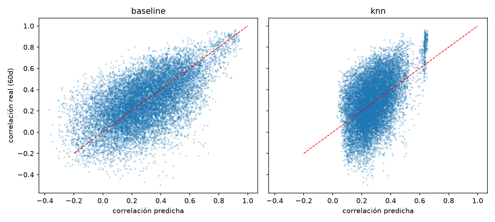

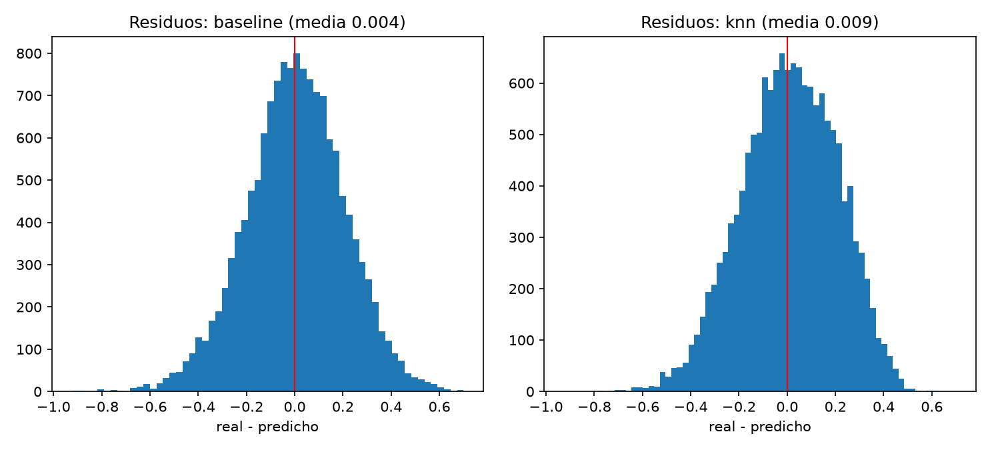

### 4.4 Análisis de errores

Un MAE promedio esconde dónde falla el modelo. Se segmentó el test (definición de _crisis_: `volatilidad_mercado` por encima del percentil 75 de train, umbral 0,0113, calculado sin mirar test).

MAE por segmento:

| Segmento          | Filas  | Baseline  | Regr. lineal | kNN   | Árbol |
| ----------------- | ------ | --------- | ------------ | ----- | ----- |
| Mercado en calma  | 8 700  | 0,156     | **0,147**    | 0,153 | 0,206 |
| Mercado en crisis | 5 655  | **0,169** | 0,171        | 0,174 | 0,193 |
| Distinto sector   | 13 431 | 0,163     | **0,157**    | 0,162 | 0,203 |
| Mismo sector      | 924    | **0,138** | 0,142        | 0,154 | 0,174 |

- **La mejora viene toda de los períodos de calma.** En crisis ningún modelo le gana al baseline.
- **El modelo subestima la crisis** (notebook `04-analisis-de-errores`, con la regresión lineal): en crisis la correlación real media es 0,38 y la predicha 0,28. Cuando el mercado se mueve en bloque las acciones se correlacionan más de lo que el modelo anticipa, porque todas las features miran el pasado y nada puede adelantar un shock que todavía no ocurrió.
- **Mismo sector:** son pocos pares (28 de 435, unas 900 filas de test) y ahí el baseline también gana.

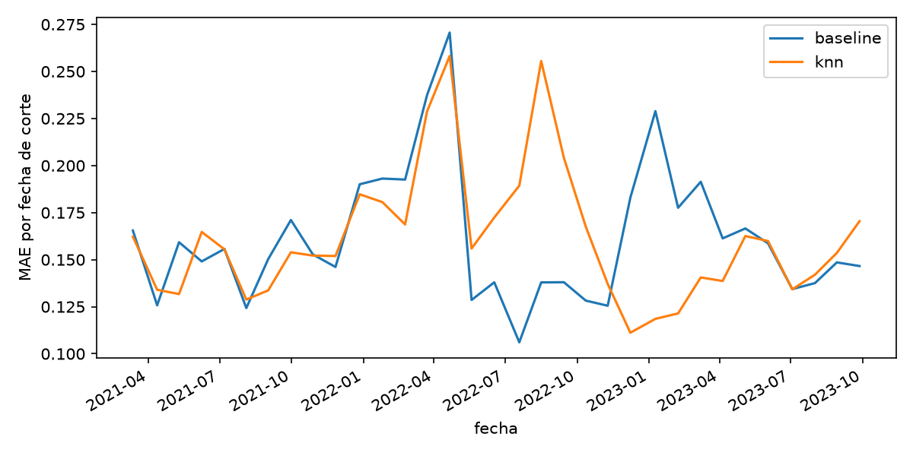

---

## 5. Algoritmos de grafos

Todos los algoritmos se implementaron a mano sobre la **matriz de adyacencia**, y sus resultados se contrastan con `networkx` en los tests (`backend/tests/`).

### 5.1 Representación: el grafo de conflicto

Dada una fecha de corte, un umbral θ y una fuente de pesos, el grafo G = (V, E) es **simple, no dirigido y con pesos**:

- Nodos: las 30 acciones.
- Arista entre i y j si ρ(i,j) > θ (desigualdad estricta); peso de la arista = ρ(i,j).

La clase `GrafoConflicto` (`backend/app/grafos/construccion.py`) guarda dos matrices de 30 × 30: `pesos` (ρ de **todos** los pares) y `adyacencia` (0/1, sale de `pesos > θ`, simétrica, diagonal en 0). Se guardan las dos porque cambiar θ solo cambia la adyacencia, y la evaluación necesita ρ de pares que no son arista. El grado de un nodo es la suma de su fila.

Con θ muy bajo el grafo se acerca al completo K₃₀ (435 aristas) y hacen falta 30 canastas; con θ muy alto no hay aristas y alcanza con 1. Es el caso extremo que se ve al mover el selector de umbral.

### 5.2 Coloreo greedy por grado

Es el algoritmo que construye las canastas (`backend/app/grafos/coloreo.py`):

1. Se separa el grafo en **componentes conexas** (BFS) y se colorea cada una por separado. Como no comparten aristas, da el mismo resultado que colorear todo junto y muestra que χ(G) = máx χ(Gᵢ).
2. Dentro de cada componente se ordenan los vértices por **grado descendente** (desempate: menor índice, para que sea determinista).
3. A cada vértice se le asigna el **menor color que no usa ninguno de sus vecinos** ya coloreados.

Cada color es una canasta. El resultado es **siempre un coloreo propio** (ninguna arista con sus dos extremos del mismo color; el código lo valida), pero **puede usar más de χ(G) colores**: el greedy es una heurística.

**Propiedades que se verifican en los tests:** sin aristas usa 1 color; Kₙ usa n; un ciclo impar usa 3; usa a lo sumo Δ + 1 colores; nunca menos que el tamaño de la clique máxima (cota inferior de χ).

**Hallazgo: el greedy por grado NO garantiza 2 colores en un bipartito.** Contraejemplo: la corona de 8 nodos (bipartito, todos de grado 3) con los nodos intercalados: el greedy usa 4 colores y DSATUR usa 2. Por eso los tests de "bipartito ⇒ 2 colores" valen para casos concretos (caminos, ciclos pares, Kₘ,ₙ, estrellas) y no como propiedad general.

### 5.3 Variantes: Welsh-Powell, DSATUR y coloreo con pesos

- **Welsh-Powell** es el mismo algoritmo: la versión clásica arma el color 0 completo, luego el 1, etc., pero da exactamente el mismo coloreo que el secuencial. Lo comprobamos en un test sobre 30 grafos al azar, en vez de implementarlo dos veces.
- **DSATUR** colorea siempre el nodo con más colores distintos entre sus vecinos (saturación) y es exacto en bipartitos. Sobre grafos al azar de 30 nodos usa casi siempre igual o menos colores que el greedy (por ejemplo, con p = 0,5: 8,39 contra 7,75 en promedio), y en bipartitos al azar el greedy usa más de 2 colores en el 13 % al 68 % de los casos mientras que DSATUR nunca lo hace (`documentacion/comparacion_coloreo.md`). Sobre los datos reales con `corr_90d` la diferencia es mínima (7,69 contra 7,64 canastas con θ = 0,5). Mantenemos el greedy por grado como algoritmo principal (es el que pide la materia) y DSATUR como comparación.
- **Greedy con pesos (idea extra).** Misma regla de orden, pero entre los colores ya abiertos que ningún vecino usa, elige el de **menor suma de ρ̂** con los nodos que ya tiene, es decir, la canasta donde el nodo queda menos correlacionado. Así el peso influye en el coloreo y no solo en qué aristas existen. Siempre da coloreo propio.

### 5.4 Contraste con el número cromático: polinomio cromático

El **polinomio cromático** P(G,λ) cuenta de cuántas formas se puede colorear G con λ colores, y cumple P(G,k) > 0 ⇔ k ≥ χ(G). Se calcula por **deleción-contracción** (P(G) = P(G−e) − P(G/e)), con caso base λⁿ sin aristas y producto de los polinomios de las componentes conexas (`backend/app/grafos/cromatico.py`). Como el costo es exponencial, el código rechaza grafos de más de 20 aristas, y se aplica a subgrafos chicos, no al grafo de 30 acciones.

Sirve para **verificar el greedy**: χ(G) es el menor k con P(G,k) > 0. En 60 grafos al azar de 8 nodos (p = 0,4), el greedy por grado usó exactamente χ en 58 y más en 2, y nunca menos. Es la confirmación empírica de que es una heurística. Los tests contrastan además el polinomio con un conteo de fuerza bruta y con fórmulas conocidas (camino, ciclo, Kₙ).

### 5.5 Otras herramientas de la materia aplicadas al mismo grafo

(`backend/app/grafos/algoritmos.py`)

- **Test de bipartición** (BFS con 2 colores): si el grafo es bipartito, χ = 2. Se usa también como test de corrección del greedy.
- **Complemento** Ḡ: una canasta es un conjunto sin aristas entre sí, o sea una clique en el complemento. Ḡ une los pares poco correlacionados, que son los que conviene combinar. Es la segunda vista del frontend.
- **Nodos de quiebre:** v es nodo de quiebre si k(G−v) > k(G) (se elimina el vértice y se cuentan las componentes). Señalan acciones que funcionan de puente entre grupos correlacionados.
- **Árbol recubridor mínimo (Prim)** sobre la distancia d = √(2(1 − ρ)), que da una vista alternativa de cómo se agrupa el mercado. Usa la matriz completa de ρ, por lo que no depende de θ.

---

## 6. Integración: del modelo al grafo

La salida del modelo es ρ̂(i,j), la correlación futura predicha de cada par en una fecha de corte. El grafo se construye así:

1. Para una fecha de corte, el modelo predice ρ̂ para los 435 pares.
2. Hay arista entre i y j si ρ̂(i,j) > θ, con peso ρ̂(i,j).
3. El coloreo greedy reparte las acciones en canastas, y χ (o la cantidad de colores usados) es el número de canastas.

**Por qué es razonable.** Una arista significa "es probable que estas dos acciones se muevan juntas en los próximos 60 días", y dos acciones unidas no pueden compartir canasta. El coloreo impone esa restricción para **todos** los pares a la vez, y la cantidad de canastas necesarias mide qué tan correlacionado está el mercado en esa fecha: cuantas más aristas, más canastas hacen falta.

**Efecto de las crisis: se cumple con la correlación histórica pero no con el modelo.** Esperábamos que en una crisis ρ̂ subiera, aparecieran más aristas y hicieran falta más canastas. Medimos el número de canastas con θ = 0,5 en las 111 fechas de corte:

| Fuente                 | Canastas, enero 2020 | Canastas, marzo-abril 2020 | Correlación entre `volatilidad_mercado` y nº de canastas |
| ---------------------- | -------------------- | -------------------------- | -------------------------------------------------------- |
| `corr_90d`             | 7 a 8                | **22 a 23**                | **0,87**                                                 |
| Modelo (kNN, k = 1000) | 4                    | 3                          | −0,17                                                    |

Con `corr_90d` el número de canastas es un buen indicador del estado del mercado: se triplica en la crisis de marzo de 2020. Con el modelo no: sus predicciones están muy suavizadas (kNN con k = 1000 promedia el target de muchísimos pares), así que casi no superan el umbral, el grafo queda ralo y el número de canastas no se mueve. Esto coincide con el análisis de errores (sección 4.4: el modelo subestima la correlación en crisis) y es una consecuencia concreta: **con la fuente `modelo` el grafo no refleja los cambios de régimen del mercado.** Esas fechas están en el período de train, así que ni siquiera es un problema de generalización. Es el punto más débil del sistema y conviene decirlo en la defensa.

**El modelo importa.** Si cambia ρ̂, cambian las aristas, el coloreo y las canastas. Esa dependencia se ve en la aplicación al cambiar el umbral, la fecha o la fuente de correlaciones.

**Fuentes de pesos intercambiables.** El grafo se puede armar con tres fuentes, que devuelven el mismo tipo de objeto, así que el coloreo y la evaluación no saben de dónde vinieron los pesos: `modelo` (correlación predicha), `corr_90d` (la línea base) y `azar` (ρ uniforme en [−1, 1], el piso de comparación). Comparar fuentes es cambiar un parámetro.

**Una limitación a tener presente.** La garantía del coloreo es sobre la correlación **predicha**: ninguna canasta contiene un par con ρ̂ > θ. Eso no garantiza que la correlación **real** de esos pares sea baja; cuánto se cumple en la práctica es exactamente lo que mide la sección 8.

---

## 7. ¿Por qué un grafo y no clustering?

Se podrían armar canastas sin grafos, por ejemplo con clustering jerárquico sobre la matriz de correlaciones. El aporte del grafo es el siguiente:

- **El clustering agrupa lo parecido; nosotros queremos agrupar lo distinto.** Un clustering sobre correlaciones junta las acciones que se mueven juntas, que es lo contrario de una canasta diversificada. Para obtener canastas diversificadas habría que tomar una acción de cada cluster, y eso ya no es una partición de las 30 acciones con una regla clara.
- **Garantía formal.** El coloreo asegura que **ningún par dentro de una canasta supera θ** (en términos de ρ̂). El clustering no ofrece una cota sobre los pares de una misma canasta.
- **El número de canastas tiene una definición matemática.** χ(G) es el mínimo de canastas necesarias para cumplir esa garantía para un θ dado, y responde a "¿cuántas canastas hacen falta?". En el clustering el número de clusters es una elección arbitraria.
- **Parámetro interpretable.** θ se lee directamente ("no quiero pares con correlación mayor a 0,5"), y el resultado cambia de forma explicable al moverlo.
- **Herramientas adicionales sobre el mismo objeto:** polinomio cromático, complemento, nodos de quiebre y árbol recubridor mínimo responden preguntas que el clustering no.

Dos salvedades honestas: el greedy es una heurística y puede usar más canastas que el mínimo (χ), y **no implementamos ni comparamos empíricamente** un método de clustering, así que esta sección es un argumento y no un resultado medido. **[REVISAR: decidir si se agrega una comparación con clustering o se deja como argumento.]**

---

## 8. Evaluación de las canastas con la correlación real de test

Para cada una de las 33 fechas de test se arma el grafo con cada fuente de ρ, se colorea con el mismo greedy por grado y se mide, con la correlación **real** de los 60 días siguientes (`corr_futura_60d`), qué tan correlacionadas quedaron las acciones de una misma canasta. **Menos es mejor.** El azar usa 20 semillas por fecha (se promedian primero por fecha). El grafo usa ρ̂ con datos hasta la fecha de corte y se evalúa con la correlación posterior, así que no hay fuga.

| θ | Variante       | Corr. real media en canastas | Pares con ρ real > θ | Canastas | Aristas |
| -------- | -------------- | ---------------------------- | -------------------- | -------- | ------- |
| 0,3      | azar           | 0,287                        | 0,481                | 6,7      | 152     |
| 0,3      | corr_90d       | 0,223                        | 0,347                | 12,1     | 202     |
| 0,3      | modelo         | 0,228                        | 0,365                | 9,8      | 172     |
| 0,3      | modelo + pesos | 0,224                        | 0,352                | 10,0     | 172     |
| 0,4      | azar           | 0,284                        | 0,317                | 5,9      | 129     |
| 0,4      | corr_90d       | 0,244                        | 0,246                | 9,5      | 133     |
| 0,4      | modelo         | 0,262                        | 0,277                | 5,7      | 60      |
| 0,4      | modelo + pesos | 0,252                        | 0,266                | 5,8      | 60      |
| 0,5      | azar           | 0,290                        | 0,187                | 5,2      | 108     |
| 0,5      | corr_90d       | 0,259                        | 0,129                | 6,9      | 74      |
| 0,5      | modelo         | 0,278                        | 0,157                | 3,3      | 15      |
| 0,5      | modelo + pesos | 0,270                        | 0,158                | 3,3      | 15      |
| 0,6      | azar           | 0,288                        | 0,087                | 4,7      | 86      |
| 0,6      | corr_90d       | 0,272                        | 0,059                | 4,7      | 33      |
| 0,6      | modelo         | 0,276                        | 0,064                | 3,0      | 9       |
| 0,6      | modelo + pesos | 0,271                        | 0,063                | 3,0      | 9       |

_(Desvío del azar entre semillas, en la correlación media: 0,012 a 0,018 según θ.)_

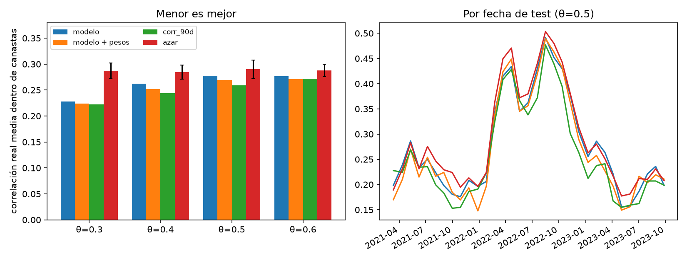

Lectura:

- **Todo le gana al azar** en todos los umbrales: el método funciona. Las canastas armadas con correlaciones (predichas o históricas) quedan menos correlacionadas que las armadas con ρ aleatorio.
- **El modelo no le gana a `corr_90d`.** Con θ = 0,3 empatan (0,228 contra 0,223) y con umbrales más altos `corr_90d` queda mejor (0,259 contra 0,278 con θ = 0,5). Es coherente con el R² chico del modelo sobre el baseline.
- **La comparación a igual θ no es del todo justa.** El modelo predice correlaciones más comprimidas hacia la media, así que supera el umbral menos veces: genera grafos más ralos (15 aristas contra 74 con θ = 0,5) y usa menos canastas (3,3 contra 6,9). Menos canastas obliga a juntar más acciones, y eso sube la correlación interna. Comparando con una cantidad parecida de canastas, el modelo con θ = 0,4 (5,7 canastas, 0,262) y `corr_90d` con θ = 0,5 (6,9 canastas, 0,259) quedan casi empatados. **Pendiente:** comparar a igual cantidad de canastas o elegir θ por fuente.
- **El coloreo con pesos mejora levemente** la correlación real frente al greedy común del modelo (por ejemplo 0,270 contra 0,278 con θ = 0,5) sin usar más canastas.
- **Las 33 fechas de test no son independientes:** están separadas por 20 días y el target mira 60, así que fechas vecinas comparten parte del período. No conviene sacar significancia estadística de ellas.

---

## 9. Aplicación web

### 9.1 Arquitectura

- **Backend (FastAPI)**: contiene toda la implementación (preparación de datos, modelo, algoritmos de grafos) y la expone por una API. Carga el modelo y el dataset una sola vez, valida los parámetros (422) y responde 404 ante fechas inexistentes. Los tests de la API están en `backend/tests/test_api.py`.
- **Frontend (React + TypeScript + Vite)**: consume la API; usa Tailwind y componentes de shadcn/ui. El slider de umbral consulta con _debounce_ de 300 ms y cancela los pedidos anteriores.

Endpoints principales:

| Endpoint                                                    | Qué devuelve                                                        |
| ----------------------------------------------------------- | ------------------------------------------------------------------- |
| `GET /fechas`                                               | Fechas de corte disponibles                                         |
| `GET /grafo?fecha&umbral&fuente`                            | Nodos con su canasta y grado, aristas con peso, y número de colores |
| `GET /canastas?fecha&umbral&fuente`                         | Canastas con sus acciones y correlación real posterior promedio     |
| `GET /chi-por-umbral?fecha&fuente`                          | Canastas y aristas para una grilla de umbrales                      |
| `GET /comparacion?umbral[&fecha]`                           | Modelo vs. `corr_90d` vs. azar (sección 8)                          |
| `GET /complemento`, `/prim`, `/nodos-quiebre`, `/polinomio` | Herramientas de grafos de la sección 5                              |
| `GET /metricas`                                             | Métricas del modelo (sección 4)                                     |

### 9.2 Pantallas

La pantalla tiene una barra superior (fecha de corte, umbral θ, fuente de correlaciones), una lista de acciones agrupadas por canasta, un panel central con pestañas y un panel derecho con las canastas.

- **Precio:** serie de la acción elegida, con la fecha de corte y las 60 ruedas a predecir.
- **Canastas según θ:** número de canastas para cada umbral (la curva que va de 30 a 1).
- **Grafo:** las acciones como nodos pintados por canasta, con vista de conflicto y vista de complemento.
- **Modelo vs. histórica:** la comparación de la sección 8.
- **Métricas del modelo:** las tablas de la sección 4.
- **Panel de canastas:** acciones de cada canasta y su correlación real posterior.

### 9.3 Capturas

Todas las capturas usan la fecha de corte 2023-09-27 (la última de test).

**Figura 1. Pantalla completa** (fuente Modelo, θ = 0,5, pestaña Precio). A la izquierda, las 30 acciones agrupadas por canasta con su precio y variación mensual; en el centro, el precio de la acción elegida con la fecha de corte y las 60 ruedas a predecir; a la derecha, las 3 canastas que resultan, con su correlación real posterior.

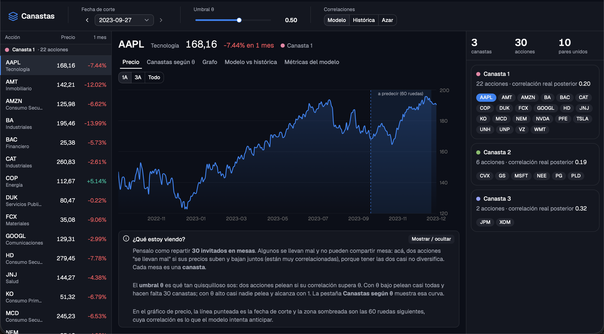

**Figura 2. Grafo coloreado con θ = 0,5**, armado con la fuente Modelo (arriba, 10 aristas) y con la fuente Histórica (abajo, 15 aristas). Cada nodo es una acción, el color indica la canasta y una arista une a las acciones cuya correlación supera θ. En ambos casos hacen falta 3 canastas, pero el grafo del modelo es más ralo.

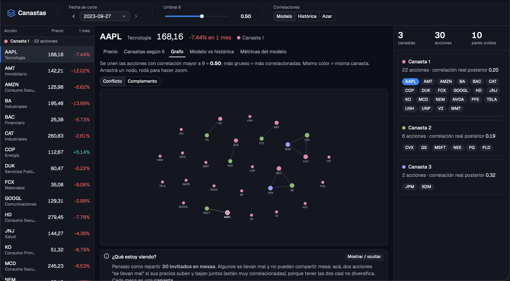

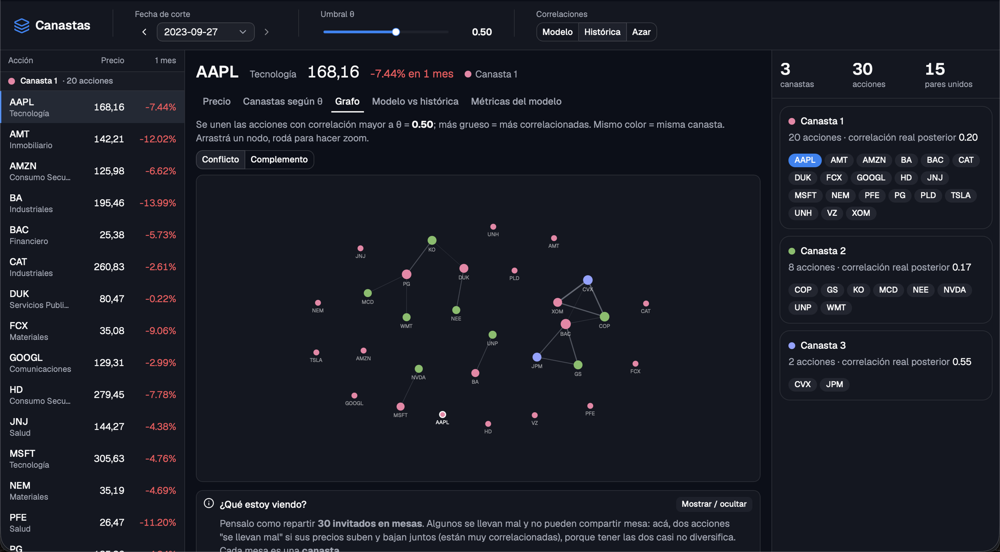

**Figura 3. Los dos extremos del umbral.** Con θ = −0,2 todos los pares superan el umbral: el grafo es el completo K₃₀ (435 aristas) y hacen falta 30 canastas, una por acción. Con θ = 1 ningún par lo supera: no hay aristas y alcanza con una sola canasta.

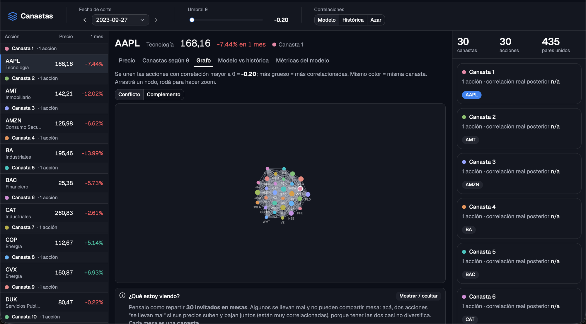

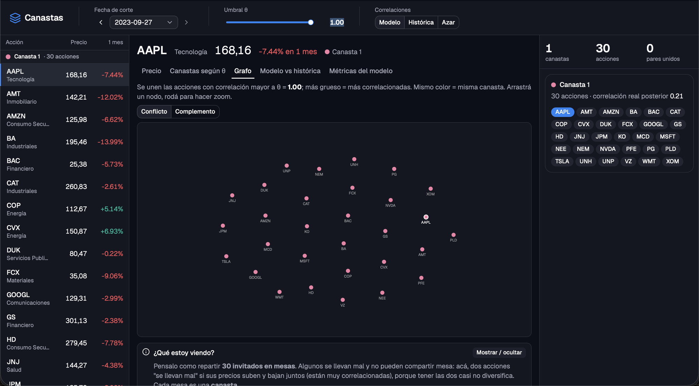

**Figura 4. La crisis de marzo de 2020** (fecha de corte 2020-03-30, θ = 0,5, pestaña Grafo). Con la fuente **Histórica** el grafo es denso (370 aristas) y hacen falta **22 canastas**; con la fuente **Modelo** es ralo (21 aristas) y alcanzan **3 canastas**. Es la diferencia de la sección 6: el grafo armado con la correlación histórica refleja el salto de correlaciones de una crisis, y el armado con el modelo no.

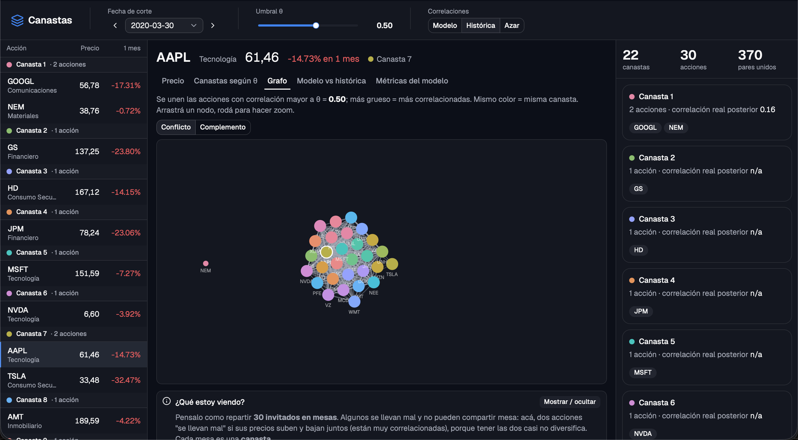

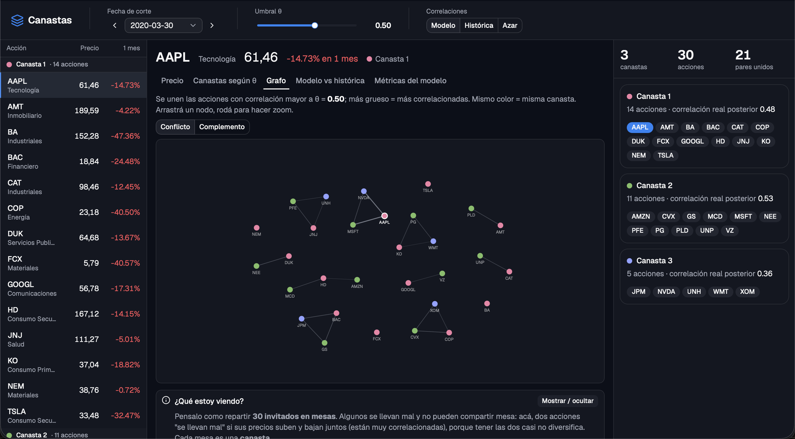

**Figura 5. Canastas necesarias según el umbral** (fecha de corte 2023-09-27, fuente Histórica, pestaña "Canastas según θ"). A la izquierda, con θ bajo, casi todos los pares superan el umbral y hacen falta cerca de 30 canastas; a la derecha, con θ alto, alcanza con una. La línea punteada marca el θ elegido (0,5), que en esta fecha requiere 3 canastas. Con la fuente Modelo la curva es más brusca: se queda en 30 canastas hasta θ ≈ 0 y baja de golpe.

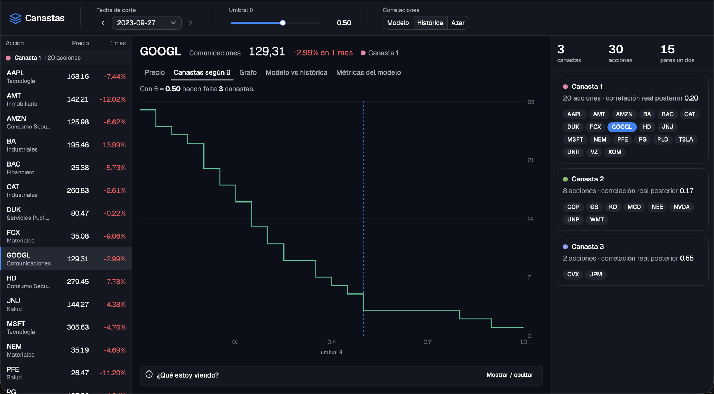

**Figura 6. Comparación de las canastas del modelo, de la correlación histórica y del azar** (pestaña "Modelo vs. histórica", promedio de las 33 fechas de test, detalle con θ = 0,5). Las barras muestran la correlación **real** media dentro de las canastas para cada umbral (menos es mejor), y la tabla da el detalle con θ = 0,5. Todos los métodos superan al azar. La histórica queda mejor que el modelo en correlación media (0,259 contra 0,278), pero usa más del doble de canastas (6,9 contra 3,3) y de aristas (74 contra 15), por eso la pestaña incluye el aviso sobre comparar con el mismo θ.

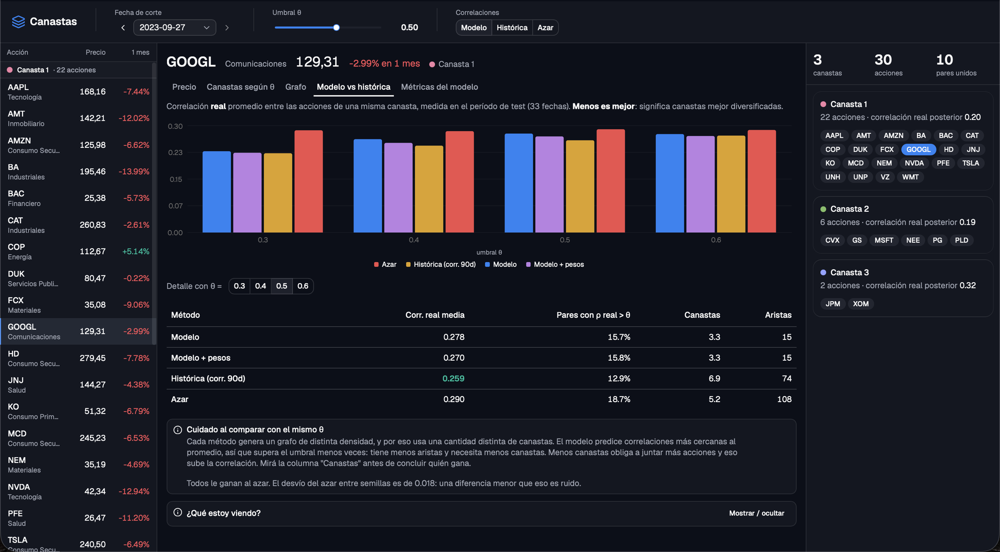

**Figura 7. Métricas del modelo** (pestaña "Métricas del modelo"). La primera tabla compara en test los tres modelos con el baseline (MAE, mejora respecto del baseline, RMSE y R²) y marca el elegido por validación; la segunda da el MAE por segmento. En el total, solo la regresión lineal mejora al baseline (3 %). Por segmento, la lineal y el kNN lo mejoran en calma y en pares de distinto sector (que son la gran mayoría), mientras que en crisis y en pares del mismo sector gana el baseline.

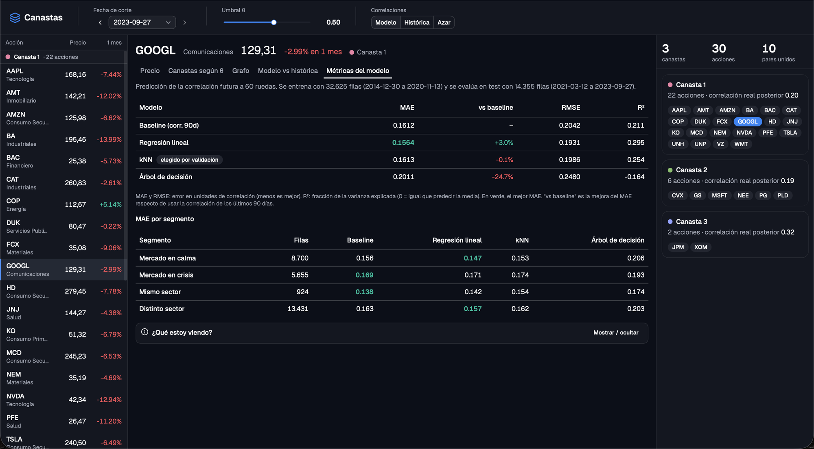

---

## 10. Uso de inteligencia artificial

**[COMPLETAR: a cargo del issue #20.]** La consigna pide: qué herramientas usaron; para qué partes sí y para cuáles no; ejemplos concretos de prompts útiles; casos en que la IA se equivocó y cómo se dieron cuenta; y una reflexión breve. Cada entrada de `documentacion/decisiones.md` marca con "Uso de IA" qué piezas se hicieron con Claude.

---

## 11. Limitaciones y extensiones

### Limitaciones

- **El modelo mejora poco al baseline** (3 % de MAE con la mejor regresión, y el kNN elegido por validación empata). La mejora viene de los períodos de calma; en crisis, que es cuando más importa diversificar, ningún modelo le gana a `corr_90d`.
- **Con la fuente `modelo`, el grafo no reacciona a las crisis:** el número de canastas casi no cambia entre calma y crisis (3 a 4), mientras que con `corr_90d` pasa de 7 a 23 en marzo-abril de 2020. La hipótesis de la propuesta ("en crisis aparecen más aristas y hacen falta más canastas") solo se cumple con la correlación histórica (sección 6).
- **Las canastas del modelo no superan a las de `corr_90d`.** Parte de la diferencia es un efecto de la comparación a igual θ (grafos más ralos, menos canastas), pero no se resolvió comparando a igual cantidad de canastas.
- **Universo chico y con sesgos:** 30 acciones que hoy están en el S&P 500 (sesgo de supervivencia); los sectores son los actuales (por ejemplo, GOOGL pasó a Comunicaciones en 2018); solo 28 de los 435 pares son del mismo sector, así que `mismo_sector` está desbalanceada.
- **Un solo período de test** (2021-2023). Las 33 fechas no son independientes, así que no hay significancia estadística.
- **Datos de `yfinance`:** no es una API oficial y su uso es personal o educativo.
- **El greedy es una heurística:** puede usar más canastas que χ(G). El polinomio cromático solo se calcula en grafos chicos (costo exponencial).
- **Una canasta no es una cartera optimizada:** no se asignan pesos de inversión ni se considera el retorno esperado. Diversificar por correlación reduce el riesgo, no garantiza ganancias.
- **Es un trabajo académico, no asesoramiento financiero.**

### Posibles extensiones

- Comparar las fuentes a **igual cantidad de canastas**, o elegir θ por fuente.
- Probar el **clustering** como alternativa y medir la diferencia.
- Más acciones, y features adicionales (retornos sectoriales, variables macro, volumen).
- Modelos más ricos que los pedidos (por ejemplo, boosting) y probar valores de `k` mayores en kNN.
- **DSATUR con pesos**, y un criterio para elegir entre colores válidos que use ρ̂ de forma más fina.
- Asignar pesos de inversión dentro de cada canasta.
- Predecir con modelos que reconozcan el régimen de mercado, para mejorar en crisis.

---

## Anexo: reproducibilidad

Instrucciones completas de instalación y ejecución en el `README.md`. Para regenerar los resultados desde `backend/` con el entorno virtual activado:

```bash
python scripts/descargar_precios.py     # data/precios.csv
python -m scripts.construir_dataset     # data/dataset_pares.csv
python -m scripts.entrenar_modelo       # data/modelo.joblib, data/metricas.json, figuras
python -m scripts.evaluar_canastas      # data/evaluacion_canastas.csv, figura
python -m scripts.comparar_coloreos     # documentacion/comparacion_coloreo.md
pytest                                   # tests, incluido el de leakage
```

Los notebooks `notebooks/01-dataset`, `02-split-y-baseline`, `03-modelos` y `04-analisis-de-errores` reproducen paso a paso el dataset, la partición, los modelos y el análisis de errores.

Documentos de apoyo: `PROPUESTA.md` (diseño del problema), `documentacion/decisiones.md` (28 decisiones con su justificación), `documentacion/preguntas-informe.md` (explicaciones en lenguaje simple) y `documentacion/evaluacion_canastas.md`.
